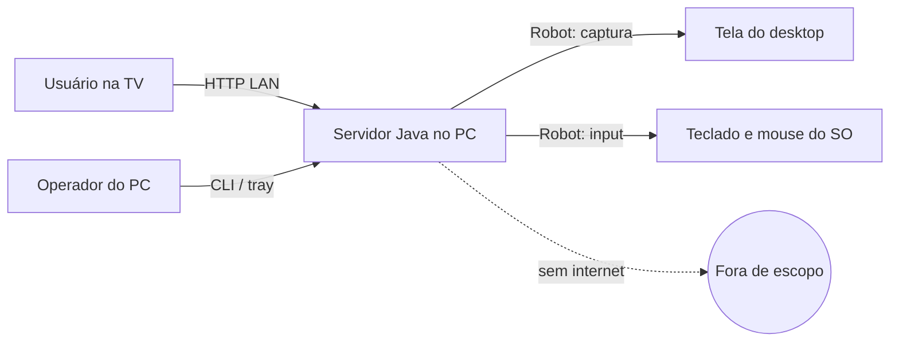
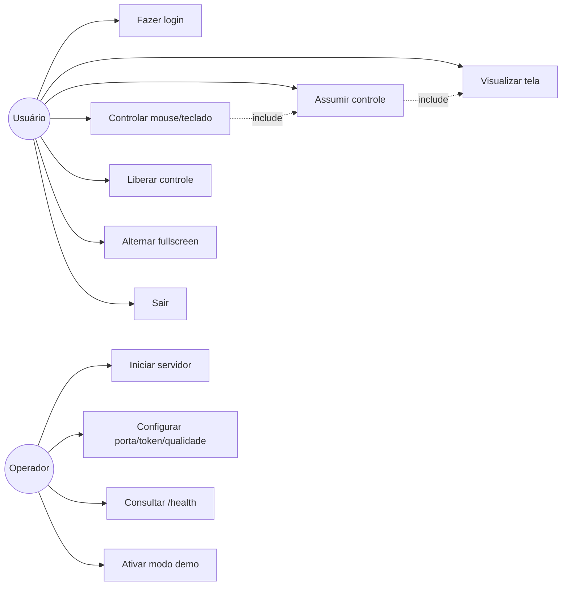
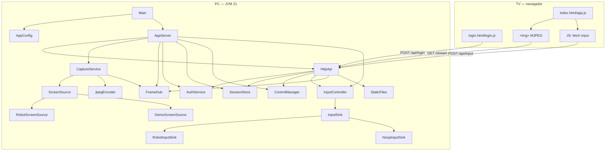
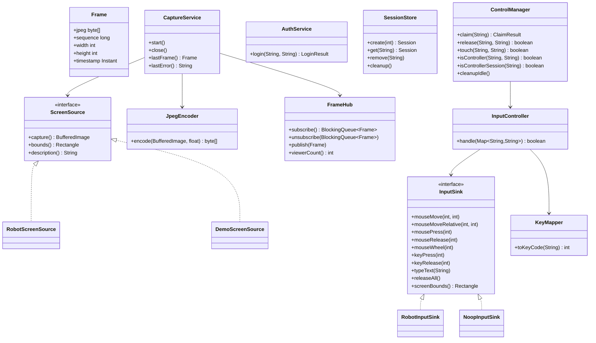
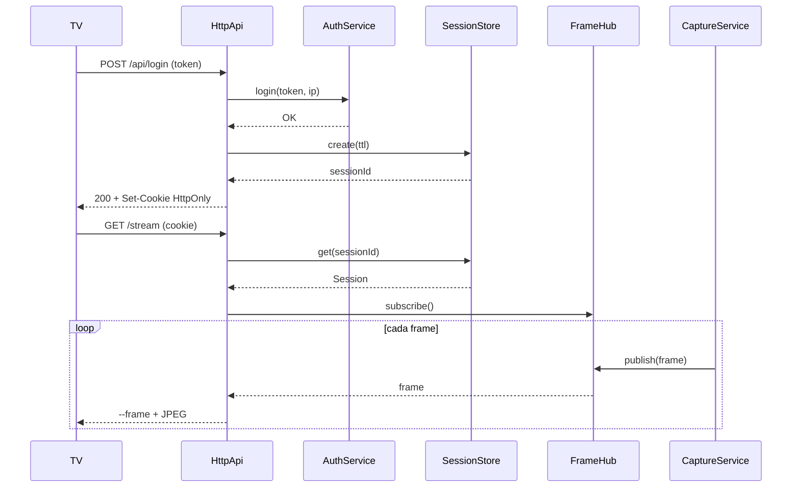
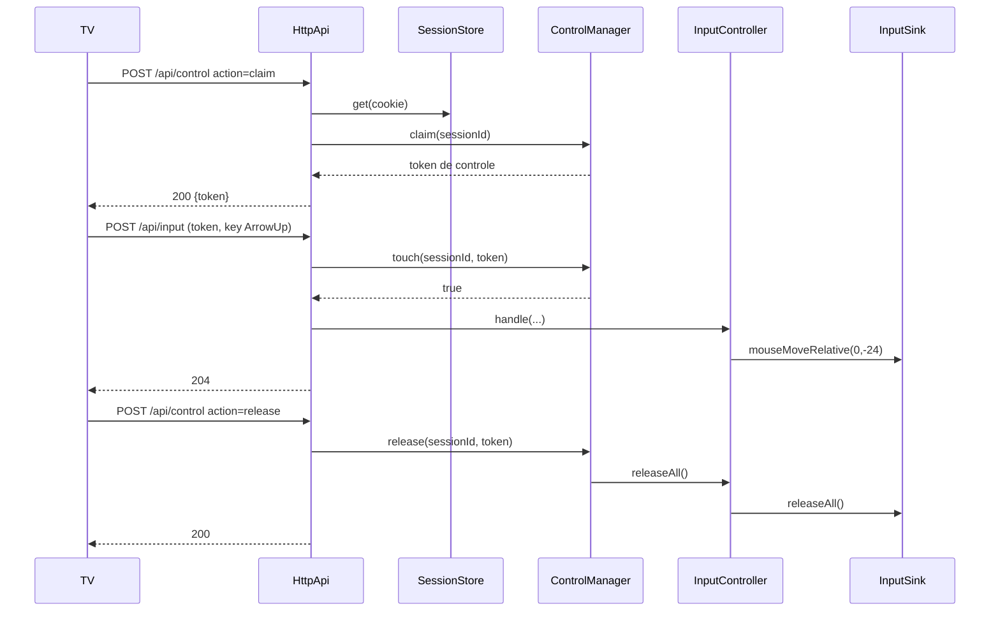
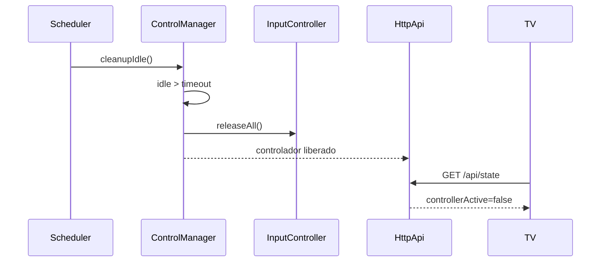

# 03 — Arquitetura e UML

## 1. Contexto



O sistema é **local-first**: não há cloud, banco de dados, fila externa ou serviço de terceiros.

## 2. Casos de uso



## 3. Componentes



## 4. Diagrama de classes



## 5. Sequência — login e stream



## 6. Sequência — assumir controle e input



## 7. Sequência — timeout e queda



## 8. API HTTP

| Método | Rota | Auth | Descrição |
|---|---|---|---|
| GET | `/` | opcional | `index.html` se sessão válida; senão `login.html` |
| GET | `/login` | não | Página de login |
| GET | `/app.js`, `/login.js`, `/style.css`, `/favicon.svg` | não | Assets estáticos |
| POST | `/api/login` | não | `token` (form) → cookie de sessão |
| POST | `/api/logout` | cookie | Invalida sessão |
| GET | `/api/state` | cookie | Estado da sessão/controle |
| POST | `/api/control` | cookie | `action=claim` ou `action=release`; claim devolve token |
| POST | `/api/input` | cookie + control token | Eventos de mouse/teclado |
| POST | `/api/heartbeat` | cookie + control token | Renova atividade do controle |
| GET | `/stream` | cookie | MJPEG `multipart/x-mixed-replace` |
| GET | `/health` | não | `ok` + versão/uptime |

### 8.1 Formato dos eventos de input
`application/x-www-form-urlencoded`, com `X-EspelhaTV: 1`:

| `type` | Campos | Efeito |
|---|---|---|
| `move` | `x`, `y` (0..1) | mouse absoluto |
| `moveRelative` | `dx`, `dy` | mouse relativo |
| `click` | `button` (1..3), `down` (true/false) | pressiona/solta botão |
| `wheel` | `delta` | roda do mouse |
| `key` | `code`, `down` | tecla |
| `text` | `text` (≤128) | digita ASCII |
| `releaseAll` | — | solta teclas/botões |

## 9. Configuração

| CLI | Env | Padrão | Descrição |
|---|---|---|---|
| `--port` | `ESPELHATV_PORT` | `8080` | Porta HTTP |
| `--bind` | `ESPELHATV_BIND` | `0.0.0.0` | Interface de escuta |
| `--token` | `ESPELHATV_TOKEN` | gerado | Token de acesso |
| `--fps` | — | `10` | FPS de captura (1–30) |
| `--width` | — | `1280` | Largura máxima do frame |
| `--height` | — | `720` | Altura máxima do frame |
| `--quality` | — | `0.60` | Qualidade JPEG (0.1–1.0) |
| `--control-timeout` | — | `300` | Segundos sem input para liberar |
| `--session-ttl` | — | `720` | Minutos de vida da sessão |
| `--cursor` | — | `true` | Desenhar cursor no frame |
| `--screen` | — | `0` | Monitor (MVP: primário) |
| `--demo` | — | `false` | Fonte sintética |
| — | `ESPELHATV_SCREENSHOT_METHOD` | `x11` em Wayland | Backend de screenshot do `Robot` (`x11`, `dbusScreencast`) |
| `--help` | — | — | Ajuda |

## 10. Concorrência

- **Captura:** um `ScheduledExecutorService` de thread única no ritmo de `fps`.
- **HTTP:** `Executors.newVirtualThreadPerTaskExecutor()`; cada stream MJPEG ocupa uma virtual thread.
- **FrameHub:** fila `ArrayBlockingQueue(1)` por cliente; o frame novo substitui o antigo (drop).
- **Controle:** `ControlManager` sincronizado; `InputController` com `synchronized` no `releaseAll`.
- **Sessões:** `ConcurrentHashMap`; cleanup agendado.
- **Queda do stream:** `HttpApi` conta streams por sessão; ao fechar o último stream do controlador, agenda `releaseBySession` com carência de 3 s. Reconexão dentro da carência cancela a liberação.
- **Shutdown:** hook chama `close()` em captura, servidor e `releaseAll()`.

## 11. Segurança

- Token de acesso nunca é logado; comparação por SHA-256 + `MessageDigest.isEqual`.
- Cookie de sessão opaco (32 bytes aleatórios), `HttpOnly`, `SameSite=Strict`, TTL.
- `X-EspelhaTV: 1` obrigatório em POST autenticado; sem CORS.
- CSP restritiva; `X-Frame-Options: DENY`; `nosniff`; `Referrer-Policy: no-referrer`.
- Stream e APIs exigem sessão; não há URL pública de vídeo.
- Rate limit de login por IP.
- Bind padrão em `0.0.0.0` para LAN; documentar firewall e não expor à internet.
- Sem TLS no MVP: usar apenas em LAN confiável/VLAN isolada.

## 12. Compatibilidade e limitações

| Cenário | Situação |
|---|---|
| webOS 3+ / Tizen 2016+ | MJPEG via ``; controle por teclado/fetch |
| webOS 1.x/2.x, NetCast, Orsay | Testar; MJPEG pode funcionar; sem garantia |
| TV sem navegador | Fora de escopo |
| Windows | Captura/input estáveis; UAC/lock screen não capturáveis |
| Linux X11 | Estável |
| Linux Wayland | XWayland/X11 costuma funcionar; portal `dbusScreencast` é experimental e pode bloquear/perder permissão; input pode ser restrito |
| macOS | Permissões de Tela e Acessibilidade |
| Áudio | Fora do MVP |
| Múltiplos monitores | Fora do MVP (primário) |

## 13. Estrutura de pastas

```text
espelha-tv/
├── pom.xml
├── README.md
├── docs/
├── scripts/
│   ├── bootstrap-toolchain.sh
│   ├── env.sh
│   ├── build.sh
│   └── run.sh
└── src/
    ├── main/java/br/com/espelhatv/
    │   ├── Main.java
    │   ├── auth/
    │   ├── capture/
    │   ├── config/
    │   ├── control/
    │   ├── input/
    │   ├── server/
    │   └── util/
    ├── main/resources/web/
    └── test/java/br/com/espelhatv/
```
